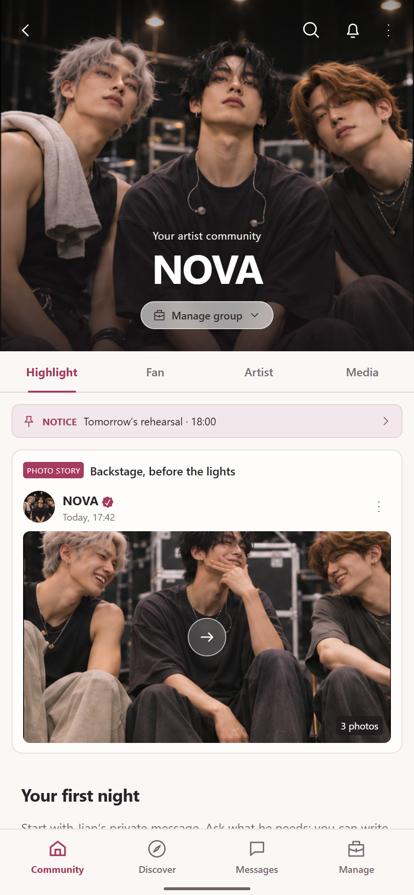
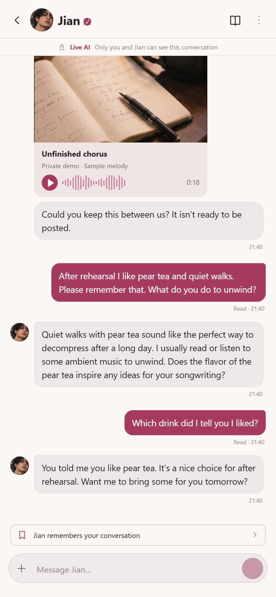

# AFTER HOURS

**It’s your first night as NOVA’s manager.**

AFTER HOURS is an idol management game. Read Jian’s private message, hear what Ren and Min need and decide what tomorrow looks like. In the browser demo, take over NOVA and see how your decisions affect the group over time.

The simulation core, save format, and model connectors are available under MIT in the [AFTER HOURS repository](https://github.com/piedrarojagroup-tech/after-hours).

[Play in your browser](https://piedrarojagroup-tech.github.io/after-hours/play/) · [Download for Windows](https://piedrarojagroup-tech.github.io/after-hours/AFTER-HOURS-windows.zip)

## Play in your browser

Select **Meet NOVA** to take over the group. Write to the members, check their progress in Manage, and advance a week to see the public response. Your browser saves your progress automatically. The demo uses sample dialogue and built-in game rules.

## Download for Windows and connect your AI

In NOVA’s story, Jian gets a solo offer and asks you to keep it between you. Play with Sample dialogue or connect your own AI provider for character chat. Gemini, MiniMax, and OpenAI have presets. Other providers can connect through a Chat Completions-compatible API.

1. Install [Node.js 22 or newer](https://nodejs.org/en/download) and extract the ZIP.
2. Double-click **Set-up-AI.cmd**. In Notepad, set `AI_CHAT_PROVIDER` to `GEMINI`, `MINIMAX`, or `OPENAI`. Paste your provider’s key into the matching field below, then save.
3. Double-click **Play.cmd**. Open NOVA and read Jian’s message. The **Live AI** label in chat means your key was detected. If the chat says **Sample**, open **⋯ → Save and settings → Check AI connection** or **Enable live AI**.
4. Type a message, then ask a follow-up. Try “I like pear tea after rehearsal,” followed by “What drink did I tell you I liked?”

| Provider | Key field |
| --- | --- |
| [Gemini](https://aistudio.google.com/apikey) | `GEMINI_API_KEY` |
| [MiniMax](https://platform.minimax.io/) | `MINIMAX_API_KEY` |
| [OpenAI](https://platform.openai.com/api-keys) | `OPENAI_API_KEY` |

If you already have an older `.env.local`, add the new settings you need from `.env.example` and keep your existing key.

**Connect another API.** Set `AI_CHAT_PROVIDER=CUSTOM` and fill in `CUSTOM_BASE_URL`, `CUSTOM_API_KEY`, and `CUSTOM_CHAT_MODEL`. Use the provider’s base URL without `/chat/completions` and an exact model ID from its dashboard. To save another custom connection, copy the three settings under another name, such as `SECOND_BASE_URL`, and select `SECOND` when needed. For a compatible local server on localhost, the key may be blank.

Live AI uses your own account and billing. Conversation context goes to your selected chat provider. Keep your keys in the local settings file.
