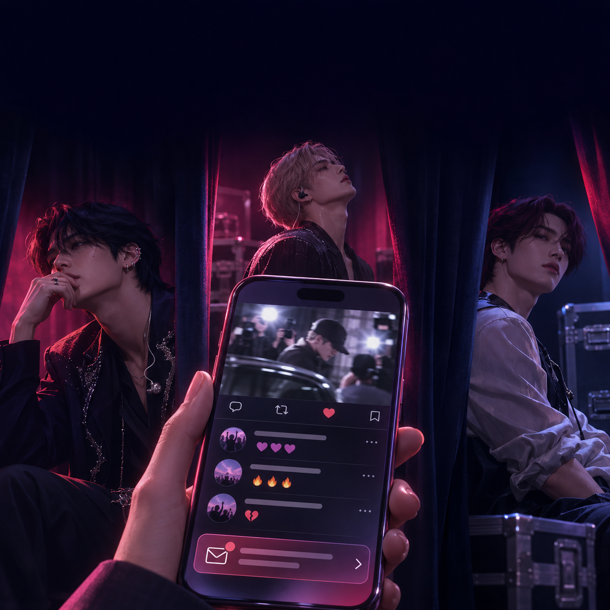
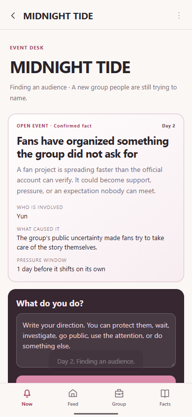

# AFTER HOURS

**It’s your first night as their manager. A photo is already spreading.**

AFTER HOURS is an idol management game. One of your members is photographed leaving a private meeting, and fans are filling in the blanks. Do you call the member first or put out a statement? Write your response and see what happens the next day.

This is a playable demo. The simulation core, save format, and model connectors are available under MIT in the [AFTER HOURS repository](https://github.com/piedrarojagroup-tech/after-hours).

[Play in your browser](https://piedrarojagroup-tech.github.io/after-hours/play/) · [Download for Windows](https://piedrarojagroup-tech.github.io/after-hours/AFTER-HOURS-windows.zip)

## Play in your browser

Select **Generate my group** and read what’s known about the photo. Try “Keep this private and talk to them first.” Review the draft, confirm it, and advance to Day 2. The browser demo runs with built-in game rules and needs no account or API key.

## Download for Windows and connect your AI

In NOVA’s story, Jian gets a solo offer and asks you to keep it between you. Play in Sample mode or bring your own AI API to chat in your own words and try AI-assisted drafts. Gemini, MiniMax, and OpenAI have presets. Other providers can connect through a Chat Completions-compatible API.

1. Install [Node.js 22 or newer](https://nodejs.org/en/download) and extract the ZIP.
2. Double-click **Set-up-AI.cmd**. In Notepad, set `AI_CHAT_PROVIDER` to `GEMINI`, `MINIMAX`, or `OPENAI`. Paste your provider’s key into the matching field below, then save.
3. Double-click **Play.cmd**. Choose **Open the fixed NOVA sample**, then **Read Jian’s message**. The **Live AI** label in chat means your key was detected. If the chat says **Sample**, open **⋯ → Save and settings → Check AI connection** or **Enable live AI**.
4. Type a message, then ask a follow-up. Try “I like pear tea after rehearsal,” followed by “What drink did I tell you I liked?”

| Provider | Key field |
| --- | --- |
| [Gemini](https://aistudio.google.com/apikey) | `GEMINI_API_KEY` |
| [MiniMax](https://platform.minimax.io/) | `MINIMAX_API_KEY` |
| [OpenAI](https://platform.openai.com/api-keys) | `OPENAI_API_KEY` |

**Use two providers together.** Save both keys in the same file. For example, set `AI_CHAT_PROVIDER=GEMINI` for character chat and `AI_DRAFT_PROVIDER=MINIMAX` for drafts. An empty draft setting uses the chat provider for both. Restart the local game server after changes.

If you already have an older `.env.local`, add the new settings you need from `.env.example` and keep your existing key.

**Connect another API.** Set `AI_CHAT_PROVIDER=CUSTOM` and fill in `CUSTOM_BASE_URL`, `CUSTOM_API_KEY`, and `CUSTOM_CHAT_MODEL`. Use the provider’s base URL without `/chat/completions` and an exact model ID from its dashboard. To save another custom connection, copy the three settings under another name, such as `SECOND_BASE_URL`, and select `SECOND` when needed. For a compatible local server on localhost, the key may be blank.

Live AI uses your own account and billing. Game context goes to the provider selected for the feature you use. Keep your keys in the local settings file.

